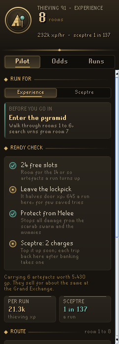
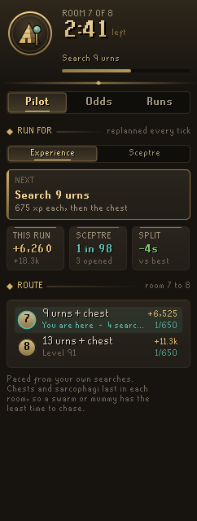
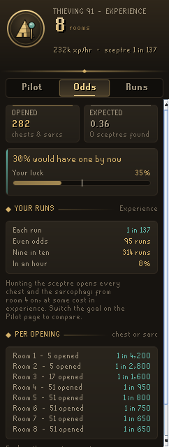
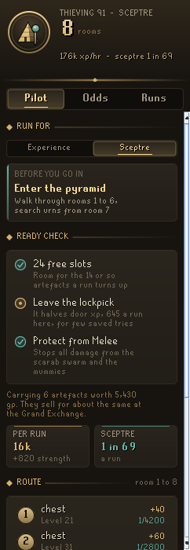
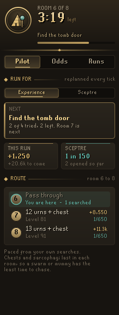
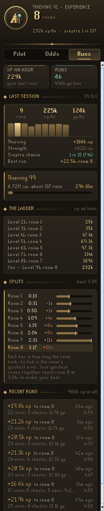
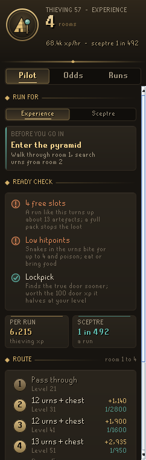
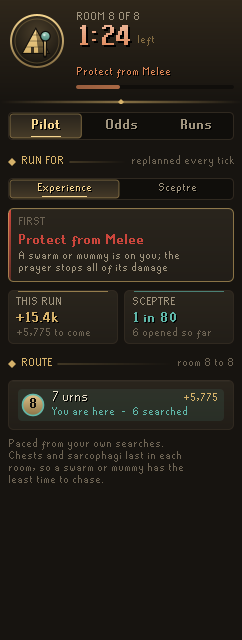
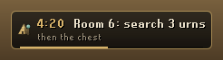
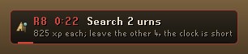

# Codex Plunder Pilot

**Every Pyramid Plunder run, planned for your Thieving level.** Which rooms to walk straight through, which urns are worth the clock, when the grand gold chest and the sarcophagus pay, and your odds of the Pharaoh's sceptre. During a run it replans every tick against the five-minute clock, says the one thing to do next, and outlines it in the room.

It is part of the **Codex** suite, with [Codex Navigator](https://github.com/Nubles/OSRS-Codex-Navigator), [Codex Guardian](https://github.com/Nubles/OSRS-Codex-Guardian), [Codex Gear Roadmap](https://github.com/Nubles/OSRS-Codex-Gear-Roadmap), [Codex Session Chronicle](https://github.com/Nubles/OSRS-Codex-Session-Chronicle), [Codex Ledger](https://github.com/Nubles/OSRS-Codex-Ledger) and [Codex Quartermaster](https://github.com/Nubles/OSRS-Codex-Quartermaster), and shares their look: warm ink, aged gold and the game's own fonts.

<p align="center">
  
  
  
</p>

## What it does

- **Pilot.** Pick what you are running for: **Experience** or the **Sceptre**. The route lists every room your level opens, what to do in each (pass straight through, so many urns, the chest, the sarcophagus) and what that pays, with the sceptre odds beside every chest and sarcophagus worth opening. Rooms your level has not opened yet are shown faded with the level that opens them.
- **During a run.** The crest becomes the clock, draining from gold to ember to blood. The next step card says exactly what to do: pass the spear trap, search 9 urns, open the chest, find the tomb door (and how many of the four you have tried). The plan is redone every tick from what is left in the room and on the clock, so a slow room shortens what follows instead of costing you the deepest room's urns. When everything worth doing is done with time to spare, it tells you to leave and start a fresh run.
- **In the room.** The urns worth searching are outlined and numbered 1, 2, 3 in the shortest walk from where you stand, worked out exactly for the room, so you never zigzag. When the plan wants fewer urns than the room holds, it picks the ones that make the shortest walk. The chest is outlined in teal, the sarcophagus in violet, the spear trap in ember and the untried tomb doors in gold, each only when it is the next step. Urns the plan skips stay dark.
- **Ready check.** Before you go in: enough free slots for the artefacts a run like yours turns up (a full pack quietly stops the loot), low hitpoints, whether a snake charm helps at your level (below 51) or slows you down, whether a lockpick is worth the door experience it halves, and Protect from Melee against the scarab swarm and mummies if you have the Prayer. It also says what the artefacts you are carrying are worth.
- **When something goes wrong.** Mid-run the next step changes to what needs doing first: Protect from Melee (or keep moving) when a swarm or mummy is on you, eat when your hitpoints are low enough for a snake to hurt, and drop the cheapest artefacts when your pack is full.
- **Odds.** Every grand gold chest and sarcophagus you open is counted by room. The page shows how many sceptres that should have turned up, how many did, and how lucky or dry you are against everyone who opened as many. For your plan it gives the chance each run, the runs to even odds and to nine in ten, and the chance in an hour.
- **Runs.** Your Thieving experience an hour over your last runs, the way to a goal level in runs and hours, when the next room opens, a ladder of the experience an hour at every room's level, and your recent runs with what each earned, how long it took and the artefacts it turned up. A sceptre run is marked in teal.
- **Splits.** Every run keeps the moment it entered each room, like a speedrunner's splits. The Runs page shows your last run to your deepest room against your best before it, room by room: when you entered, how far ahead or behind, and a bar for how long each room took with a tick at its quickest crossing ever (a gold diamond when you matched it). Your quickest rooms strung together give the run you have in you. During a run a Split tile says how far ahead or behind your best you entered the room, and the run summary calls out a new best. Runs are only compared with runs for the same goal that reached the same room.
- **Session.** Runs played back to back (no break over twenty minutes) make a session: runs, experience and artefact coins an hour with the walk back counted, a bar for every run, your best run, and the sceptre chance the session's chests and sarcophagi carried together.
- **Pharaoh's sceptre.** The ready check warns when your sceptre is out of charges, counts its charges once the game has named them, and suggests bringing it when it is in your bank: its Jalsavrah teleport lands right at the pyramid. With [Codex Gear Roadmap](https://github.com/Nubles/OSRS-Codex-Gear-Roadmap) installed, the bank it last saw counts too.
- **Plaque.** A slim plaque in the game view during a run with the room, the clock and the next step.
- **Run summary.** When a run ends, a line in the chat box with the room reached, the experience, the artefacts, the sceptre odds the run carried, a new best to the deepest room and the session's rate.

<p align="center">
  
  
  
</p>
<p align="center">
  
  
</p>
<p align="center">
  
  
</p>

## How it plans

The figures are the game's, as the Old School wiki records them: experience for each room's urns, chest and door, the Strength experience from each sarcophagus, and the sceptre rate per chest or sarcophagus (1 in 4,200 in room 1 down to 1 in 650 in rooms 7 and 8).

Getting through each room (the trap, the true door among four and the walk) costs a fixed time. What is left of the five minutes is shared out among the urns, chests and sarcophagi by what your goal values most per tick, which is why the deepest two rooms get the urns and the shallow rooms are walked through:

- **Experience** opens the chests from room 4 on first (they are quick and pay in artefacts and sceptre chances), then searches urns from the best-paying room down while the clock allows.
- **Sceptre** opens every chest and the sarcophagi from room 4 on, where their odds are best, before any urn. At 91 that is a sceptre chance of about 1 in 69 a run, against 1 in 137 for an experience run.

The plan starts from typical times (an urn about six seconds with the odd failure, a room's trap, door and walk about fifteen) and learns your own from your runs. Chests and sarcophagi come last in each room so a scarab swarm or mummy has the least time to chase you.

Everything is saved per account in your RuneLite profile.

## Rules posture

Codex Plunder Pilot only reads what the game already shows you: your Thieving, Strength, Hitpoints and Prayer, your pack and bank, the room, the clock, which urns, chests and doors are open, and whether a swarm or mummy is after you. It outlines objects and draws its own panel and plaque. It does not click, change menus, or send anything over the network; you do every click.

## Development

```bash
./gradlew build   # compile and run tests
./gradlew run     # launch RuneLite with the plugin loaded
```

The planner, odds and run tracking (`core/`) are plain Java with unit tests; the panel and overlays are in `ui/` and `overlay/`.

## Licence

BSD 2-Clause, see [LICENSE](LICENSE).
